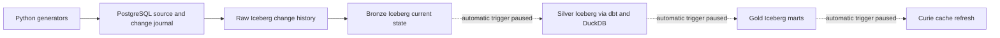

# Ampere data platform

Ampere generates operational data in PostgreSQL and publishes Iceberg tables on MinIO through Lakekeeper. Task 6's v4 source journal, Raw transfer, and Bronze current-state implementation is prepared in this checkout but is not released or deployed. The cluster remains on its previous runtime until the owner publishes the release and performs the dataset/catalog cutover.

The init DAG defaults to the existing destructive source reset/bootstrap. Trigger it with `{"source_init_mode":"journal_migrate"}` to install source identities, capture triggers, and a baseline on existing rows without truncating or reseeding them. This migration preserves current rows but treats them as one baseline; it cannot recreate historical daily changes that were not captured. New generation starts after the latest existing `orders.order_date` to prevent accidental replay of uncaptured dates.

## Daily pipeline



The scheduled generator runs at `15 4 * * *` (04:15 in the Airflow DAG timezone), journals each source date atomically, and triggers Raw. Raw transfers a fixed completed-batch boundary and then triggers Bronze. Bronze processes snapshots/mutable dimensions and facts/events in two sequential Spark applications; the latter advances the transfer checkpoint after both groups finish. The chain stops at Bronze; automatic Silver, Gold, and Curie handoffs remain disabled until the owner authorizes their restoration. The manual backfill accepts an inclusive date range in one generator pod, commits one bounded transaction per calendar month, and does not trigger downstream work. The Bronze full-rebuild DAG uses the same two groups over accepted Raw history at one frozen boundary. See [Airflow orchestration](docs/dataflow/generated/airflow_dag_orchestration.md).

The canonical [contract v5](tools/contracts/ampere_tables.json) defines 58 tables across Raw, Bronze, Silver, and Gold. PostgreSQL `source_changes` stores compact row identity, operation, and batch metadata; Raw joins those records to the source tables during transfer and preserves typed change history. Bronze stores current source state with dataset and stable row lineage, source-order version guards, and delete application. Catalog initialization creates contract tables and refuses schema/layout conflicts; it does not migrate or drop existing Iceberg tables automatically. Silver and Gold dbt/DuckDB models and manual rebuild DAGs remain available but isolated from automatic triggers during Task 6 validation.

Weekly housekeeping uses the Spark Connect client to submit contract-driven compaction, manifest rewrite, snapshot expiration, and orphan cleanup. It checks table schema, partitioning, and properties before maintenance.

## Repository layout

- `dags/`: Airflow DAGs, table-group configuration, and SparkApplication templates.
- `docker/spark/iceberg_raw_etl/`: Spark applications for PostgreSQL journal-to-Raw and Raw-to-Bronze.
- `docker/spark/connect_client/`: Spark Connect client for catalog initialization and housekeeping.
- `docker/dbt_iceberg/` and `dbt_iceberg/`: dbt v2 runtime, SQL models, tests, and Iceberg publisher.
- `docker/init_source_preparation/` and `docker/order_data_generator/`: source initialization and synthetic generation.
- `tools/contracts/`: canonical Iceberg contract and shared resolver.
- `tools/budget_generation/`: tracked budget input and daily budget generation.
- `docs/`: generated dataflow diagrams and operational documentation.
- `tests/`: checks for the Spark and dbt paths.

## Images and releases

A numeric `vX.Y.Z` tag runs [release-images.yml](.github/workflows/release-images.yml). It publishes `ampere-spark-iceberg`, `ampere-dbt-iceberg`, `init-source-preparation`, and `order-data-generator`. Airflow's `ampere_release_version` selects the default tag. `iceberg_spark_image` and `iceberg_dbt_image` can override images; the Spark override applies to both Raw and Bronze. These values are managed in Airflow, not in the common deployment environment.

The Iceberg Spark and dbt workflows build `sha-<commit>` on relevant pushes to `main`; release tags publish coordinated image versions. The release workflow uses `GHCR_TOKEN` when present and otherwise `GITHUB_TOKEN` for GHCR access.

## Documentation

[Project dataflow](docs/dataflow/generated/project_dataflow.md), [table groups](docs/dataflow/generated/table_groups.md), [layer responsibilities](docs/dataflow/generated/layer_responsibilities.md), and [Airflow orchestration](docs/dataflow/generated/airflow_dag_orchestration.md) are generated from `docs/dataflow/dataflow.yml`, DAG metadata, and table-group configuration. Regenerate them with:

```bash
uv run python tools/docs/generate_dataflow_docs.py
```

See [the platform overview](docs/README.md), [Spark runtime](docker/spark/iceberg_raw_etl/README.md), and [Silver/Gold runtime](dbt_iceberg/README.md) for details.
